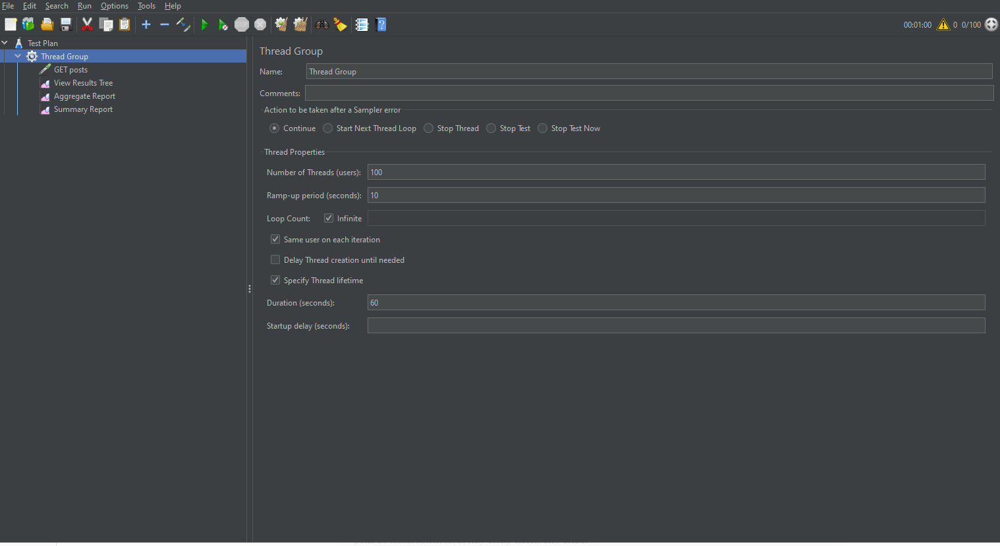
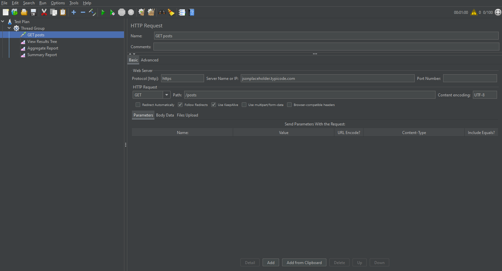
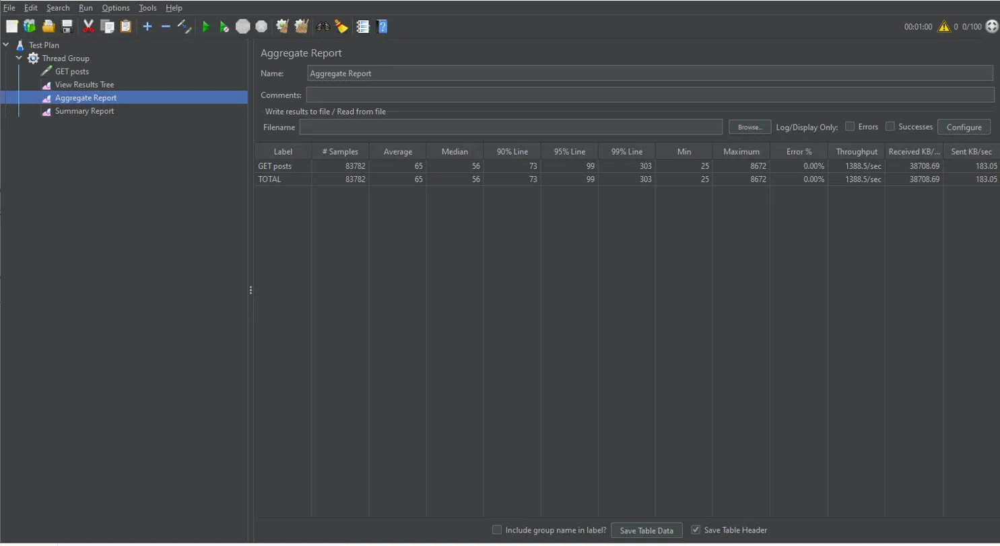

# Kiểm thử hiệu năng API với Apache JMeter
**Công cụ:** Apache JMeter 5.6.3 | **Đối tượng:** https://jsonplaceholder.typicode.com/posts

## 1. Giới thiệu JMeter

Apache JMeter là công cụ mã nguồn mở viết bằng Java, dùng để kiểm thử hiệu năng và kiểm thử tải bằng cách mô phỏng nhiều người dùng ảo truy cập hệ thống cùng lúc. Các thành phần chính: **Thread Group** (số người dùng ảo), **Sampler** (gửi request), **Listener** (hiển thị kết quả).

## 2. Kịch bản kiểm thử

**Mục tiêu:** mô phỏng 100 người dùng ảo truy cập API `GET /posts` trong 60 giây, đánh giá độ ổn định và thời gian phản hồi.

**Thread Group**

| Tham số | Giá trị |
|---|---|
| Number of Threads | 100 |
| Ramp-up period | 10 giây |
| Loop Count | Infinite |
| Duration | 60 giây |

**HTTP Request**

| Tham số | Giá trị |
|---|---|
| Protocol | https |
| Server Name | jsonplaceholder.typicode.com |
| Method / Path | GET / `/posts` |
| Encoding | UTF-8 |

**Listener:** View Results Tree, Aggregate Report, Summary Report.

## 3. Kết quả

| Chỉ số | Giá trị |
|---|---|
| Tổng số request | 83.782 |
| Thất bại (Error %) | 0 (0,00%) |
| Average / Median | 65 ms / 56 ms |
| 90% / 95% / 99% Line | 73 / 99 / 303 ms |
| Min / Max | 25 ms / 8.672 ms |
| Throughput | 1.388,5 request/giây |

## 4. Phân tích

- **Độ ổn định:** 83.782 request không có lỗi nào, tỷ lệ thành công 100%.
- **Thời gian phản hồi:** trung bình 65 ms, 95% request dưới 99 ms. Median gần với Average nên phần lớn request có tốc độ đồng đều.
- **Request chậm:** 99% Line là 303 ms và Max là 8.672 ms, cho thấy một số ít request chậm bất thường (có thể do mạng hoặc máy chủ, chưa đủ dữ liệu để kết luận nguyên nhân).
- **Throughput:** rất cao do kịch bản không có Timer, mỗi user gửi request liên tục, nên đây là mức tải tối đa chứ không phải hành vi người dùng thật.

## 5. Kết luận

Dưới tải 100 người dùng ảo trong 60 giây, API `GET /posts` hoạt động **ổn định và nhanh** (0% lỗi, trung bình 65 ms, ~1.388 req/s). Cần lưu ý một số ít request chậm bất thường. Hướng mở rộng: thử thêm mức tải 50/200 thread, thêm Timer và Assertion.

